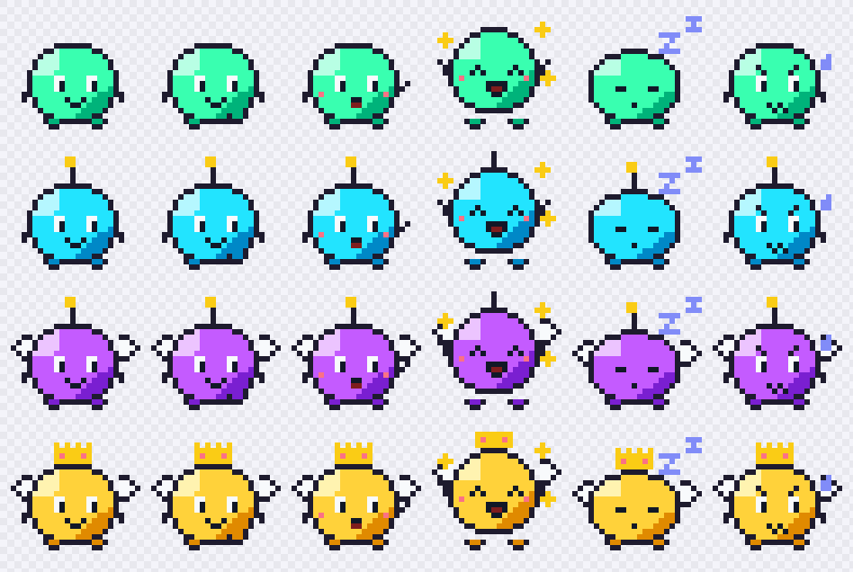

# body-double (working name)

A proactive focus companion for ADHD brains, built on the [pi](https://github.com/earendil-works/pi) agent runtime.

It notices when you drift, **speaks first** with **one next action you can do in under two minutes**, remembers
what works for you, and turns finished work into a game: XP, levels, skills, titles, boss fights for deadlines,
streaks that forgive a missed day. A pixel familiar lives on your screen and evolves as you level up.



## Why
Most focus tools wait for you to open them, which is exactly what an ADHD brain doesn't do. This one watches
(privately), speaks up when you drift, keeps the ask tiny, and makes progress visible, because visible progress is
what keeps going.

## Quick start (Windows, Node 22+)
```bash
npm install
npm test            # 43 tests, no API key needed
npm run test:pet    # launches the real pet, drives it, saves 4 screenshots, checks them
npm run pet         # the pixel familiar (starts the background service if needed)
```
No model key is required: nudges fall back to templates. With a key, nudges are written by the model and long
unclear stretches get judged (see Settings):
```
META_API_KEY=...            # Meta Model API (Muse Spark via pi-ai's Meta provider), or
ZAI_API_KEY=...             # z.ai (GLM 5.3) with BD_PROVIDER=zai
```

## Three ways to use it
- **Through Claude (no typing elsewhere).** Register the MCP server once: `node scripts/register-mcp.mjs`
  (backs up `~/.claude.json`, adds one entry; `--remove` undoes it). Then say "I'm starting Banafah, steps are …",
  "done with that", "that nudge was wrong", "how am I doing today?". Tools: `companion_status`, `companion_add_quest`,
  `companion_complete_step`, `companion_activate_quest`, `companion_add_steps`, `companion_pause` (with minutes =
  snooze), `companion_feedback`, `companion_rules`, `companion_forget_rule`, `companion_today`, `companion_stats`,
  `companion_report`, `companion_import_jarvis`.
- **The pet.** Lives along the bottom of the screen; clicks pass through everywhere except the pet and its bubble.
  Nudges appear in a speech bubble with **Done ✓ / Snooze 10m / Wrong nudge**. Click the pet (or tray icon, or
  Ctrl+Alt+B) for the panel: level, XP, active quest with boss HP and deadline, next step, streak, skills, titles,
  nudge stats, quest switcher, JARVIS import, stats page. Hotkeys: Ctrl+Alt+D done, Ctrl+Alt+P pause.
- **Terminal.** `npm start`: single-letter commands (`add`, `d`, `s`, `p`, `w`, `m`, `rules`, `forget`, `r`).

## How it decides
```
active window (title + app, every 15 s, ~50 ms)
  -> rules: quest keywords (on task) / quest + global distractions (drift) / idle (away) / otherwise unclear
  -> unclear for 6 min on one site/app -> the judge (model) decides once, cached 30 min
  -> drift tracker: nudge after ~3 min of drift (tuned by feedback), cooldown 5 min, never while away
  -> brain (pi agent): one message + one next action, or split a big step first; templates if no model
  -> stuck: 25 min on task without finishing -> offer a smaller step
  -> morning plan / evening "what you won today"
```
Feedback teaches it: **wrong nudge** makes that trigger fine for the quest and waits 30 s longer next time;
**missed drift** blocks the site/app it saw for the quest and reacts 30 s sooner. Every learned rule can be listed
and undone.

## Game rules
- XP for **finished steps**, never for time and never from the model. ×1.5 comeback bonus when you finish within
  5 min of a drift or stuck nudge.
- Skills level separately (Client Work, Code, Admin, …). Titles for milestones (First Step, Comeback Kid, Boss
  Slayer, On a Roll, Deadline Hunter, Centurion).
- Deadlines are bosses with an HP bar of remaining steps; +50 XP when defeated.
- Streak shield: one free missed day per week; a broken streak restarts at 1, never 0.
- The familiar evolves at levels 5, 10 and 20 (antenna, wings, crown).

## Privacy
- Window titles are held **in memory only** (last 15 min) and never written to disk. The log keeps app names, the
  rule that fired, and short site keys of learned rules.
- The model sees quest text and stats for nudges. The judge sees the app and window title of the stretch it judges;
  screenshots only if you set `BD_JUDGE=screenshot` and the model accepts images; nothing is stored. `BD_JUDGE=off`
  disables it.
- Everything lives in `%APPDATA%\body-double\` (`state.json`, `stats.html`, `daemon.json`). The service listens on
  127.0.0.1 only, behind a random token.

## Settings (`.env`)
| Setting | Default | What it does |
|---|---|---|
| `BD_PROVIDER` | auto | `meta`, `zai` or `none` (auto picks from the keys present) |
| `BD_MODEL` | provider default | e.g. `muse-spark-1.3`, `glm-5.3` |
| `BD_JUDGE` | `title` | `title`, `screenshot` or `off` |
| `BD_UNCLEAR_MINUTES` | 6 | unknown site/app this long before the judge is asked |
| `BD_STUCK_MINUTES` | 25 | on task this long without finishing before a smaller step is offered |
| `BD_DRIFT_SECONDS` | 180 | starting nudge delay; feedback tunes it within 90–600 s |
| `BD_MORNING_HOUR` / `BD_EVENING_HOUR` | 6 / 19 | day plan / day summary |
| `BD_SAMPLE_SECONDS` | 15 | how often the active window is read |
| `BD_PORT`, `BD_DATA_DIR` | 47821, `%APPDATA%\body-double` | service port and data folder |

## Evidence
`npm run stats` writes a standalone page from your real log: totals, drifts by hour, per-day table, nudge sources,
judge verdicts, and the kill-test view. It is framed as what it is: one person's use, not a study.

## Architecture
| Path | Role |
|---|---|
| `src/core/watcher.js` | foreground window + idle time via one long-lived PowerShell helper; self-healing |
| `src/core/classifier.js` | rules → on-task / drift / away / unclear, with the rule that fired |
| `src/core/drift.js` | drift episodes, cooldown, returns |
| `src/core/game.js` | XP, levels, skills, titles, bosses, streak shields (deterministic) |
| `src/core/store.js` | atomic JSON state |
| `src/agent/brain.js` | pi agents: nudge/split brain with template fallback; the judge |
| `src/companion.js` | the heartbeat that ties it together (+ learning, stuck, bookends) |
| `src/daemon.js` | background service: JSON API + live events (127.0.0.1, token) |
| `src/mcp.js`, `src/client.js` | Claude tools; shared client that starts the service |
| `src/pet/*` | Electron pet + panel; procedural pixel art; behaviour |
| `src/stats.js` | evidence page |

## Status and limits
Hackathon build. Windows only (the watcher uses Win32 calls through PowerShell). Without a model key, nudges are
templates and unclear stretches are never judged. The kill test (≥ 4 of 5 real drifts caught, ≤ 1 wrong nudge in one
real work hour) has not been run yet.

MIT licence.
