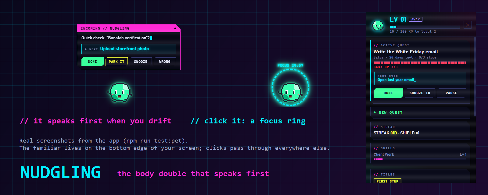

# Nudgling — the body double that speaks first



**Nudgling is a proactive focus companion for ADHD brains.** A small pixel creature lives on the bottom edge of
your screen. When you drift, it speaks first, with **one next action you can do in under two minutes**. It
learns from your feedback, and it turns finished work into a game: XP, levels, bosses, streaks that forgive.
The creature evolves as you level up.

Built for the **Meta Global AI Developer Hackathon** (Indie · Build for Your World). Agent runtime:
[pi](https://github.com/earendil-works/pi). Words come from **Meta's Muse Spark** in the cloud, or from **Meta's
Llama 3.2 on your own PC**.

## Why
I have ADHD. Every focus tool I've tried waits for me to open it, and that is exactly what an ADHD brain doesn't
do. A *body double*, someone sitting next to you while you work, is one of the few things that reliably helps.
Nudgling is a body double that is always there. It notices when you drift and starts the conversation, keeps the
ask tiny, and makes progress visible, because visible progress is what keeps you going.

## What it does
- **Speaks first when you drift.** It watches which window is in front (titles are held in memory only). After a
  few minutes on something unrelated, the bubble names your quest and one tiny next step. Buttons: **Done**,
  **Park it** (save the distraction for later), **Snooze**, **Wrong**.
- **Learns you.** "Wrong" and "you missed it" teach it, per quest: YouTube can be research for one quest and a
  trap for another. It also tunes how long it waits before speaking (90–600 s).
- **Focus ring.** Click the creature → **FOCUS 25 / 50**. A ring counts down around it, then gives you a 5-minute
  break during which it stays quiet.
- **Notices more than drift.** It offers a smaller step when you're stuck on one for 25 minutes. It opens your
  day with a plan and closes it with what you won.
- **Progress is the game.** XP only for finished steps (never for time, never from the model). Deadlines are
  bosses with HP bars. Streak shields forgive a missed day. Titles, skills, and four evolution stages.
- **Works from Claude.** Click **Connect Claude** in the HUD once (it backs up `~/.claude.json` first; a second
  click undoes it). Then say "I'm starting the Banafah verification, steps are …" or "done with that" in any
  Claude chat, and Claude drives the companion through MCP tools.

## Meta AI inside
| Job | Model | Where it runs |
|---|---|---|
| Write the nudge, split a big step into tiny ones (pi agent with `nudge` / `split_step` tools) | **Muse Spark** (Meta Model API, via pi-ai's Meta provider) | Meta's cloud, when a key or Muse sign-in is set |
| Same job, offline and free | **Llama 3.2 3B Instruct** (Meta) on llama.cpp | **this PC** (127.0.0.1) |
| Decide whether an unclear window fits the quest | Kev-0.8B decision model (probabilities, no text) | this PC |

The writers form a chain: Muse Spark → Llama on this PC → built-in templates. If one gives no nudge (no credits,
offline), the next one writes it, so the companion never goes silent. With Llama, **nothing about your screen
leaves the machine**. The model only gets abstract facts ("drifted 4 min from *Banafah verification*, next step
*Upload storefront photo*").

## Start it
**On Samir's PC:** double-click **Nudgling** on the Desktop. It also starts by itself at login.

**On a fresh Windows PC (Node 22+):**
```bash
npm install
npm run setup:models    # llama.cpp + Kev-0.8B + Llama 3.2 3B from official sources, SHA-256 pinned (~3 GB)
npm run pet             # the creature appears; it starts the service and both local models itself
node scripts/autostart.mjs   # optional: start at login + Desktop icon (--remove undoes it)
```
Optional cloud model: click **Sign in with Meta** in the HUD (enter the code on Meta's page), or put `META_API_KEY=...`
in `.env`. Muse Spark then goes first and Llama becomes the backup. The HUD's AI card shows which models are active.

Check it yourself:
```bash
npm test               # 68 tests, no key and no model needed
npm run test:pet       # launches the real app, drives it, saves 8 screenshots, checks them
npm run eval:decider   # the local decision model on 40 labelled window titles
```

## How it decides
```
active window (title + app, every 15 s, ~50 ms)
  -> rules: quest keywords (on task) / quest + global distractions (drift) / idle (away) / otherwise unclear
  -> unclear for 6 min on one site/app -> the local decision model decides once (cached 30 min)
       quiet unless it is >= 75% sure
  -> drift tracker: nudge after ~3 min of drift (tuned by feedback), cooldown 5 min, never while away or on break
  -> pi agent (Muse Spark -> Llama -> template): one message + one next action, or split a big step first
  -> stuck: 25 min on task without finishing -> offer a smaller step
  -> morning plan / evening "what you won today"
```

## Privacy
- Window titles stay **in memory only** (last 15 min) and are never written to disk. The log keeps app names,
  the rule that fired, and short site keys of learned rules.
- Decisions about your windows run on **this PC** (Kev). Nudge text runs on this PC (Llama), or at Meta if you
  add a key; it never contains a window title.
- No screenshots unless you explicitly set `BD_JUDGE=screenshot`. The service and the models listen on
  127.0.0.1 only; the service needs a random token.

## Evidence
See [docs/EVIDENCE.md](docs/EVIDENCE.md): automated tests, a 20-minute soak test, and the decision-model eval
with real numbers, including where the first model failed. `npm run stats` builds a page from your own log.
That page is one person's use, not a study.

## Architecture
| Path | Role |
|---|---|
| `src/core/watcher.js` | foreground window + idle time via one long-lived PowerShell helper; self-healing |
| `src/core/classifier.js`, `drift.js` | rules → on-task / drift / away / unclear; drift episodes, cooldown, returns |
| `src/core/game.js`, `store.js` | XP, levels, skills, titles, bosses, streak shields (deterministic); atomic JSON state |
| `src/agent/brain.js` | pi agents: the nudge/split brain with the model chain and template fallback; the judge |
| `src/agent/decider.js` | local decision model through pi-ai's System One classifier API |
| `src/core/decider-server.js` | starts llama.cpp with Kev and Llama when the service starts |
| `src/companion.js` | the heartbeat: learning, stuck, bookends, vault, focus sessions |
| `src/daemon.js`, `src/mcp.js` | background service (JSON API + live events); Claude tools |
| `src/pet/*` | Electron creature, bubble, focus ring, HUD; procedural pixel art |

## Settings (`.env`, all optional)
| Setting | Default | What it does |
|---|---|---|
| `META_API_KEY` | – | Muse Spark writes nudges first |
| `BD_DECIDER` | `kev` | local decision model: `kev`, `kev-4b`, `julia` or `off` |
| `BD_WRITER` | on | `off` skips the local Llama |
| `BD_DECIDER_THRESHOLD` | 0.75 | below this the decision model stays quiet |
| `BD_DRIFT_SECONDS` | 180 | starting nudge delay; feedback tunes it within 90–600 s |
| `BD_STUCK_MINUTES` / `BD_UNCLEAR_MINUTES` | 25 / 6 | stuck offer / when the decider is asked |
| `BD_MORNING_HOUR` / `BD_EVENING_HOUR` | 6 / 19 | day plan / day summary |

## Status and limits
- Windows only (the watcher uses Win32 through PowerShell).
- The creature's look is a first version; it evolves in four stages, and a richer character is next.
- Real-use evidence is one person (n = 1).

## Credits and licences
MIT for this code. **Built with Llama**: Llama 3.2 is licensed under the Llama 3.2 Community License, © Meta
Platforms, Inc. Kev (jaredpalmer/kev, Apache-2.0, on Qwen3.5). Julia-1 (SupersonicLabs, Apache-2.0).
llama.cpp (MIT). pi agent runtime (earendil-works). Models are downloaded by `setup:models`, not stored in
this repo.
